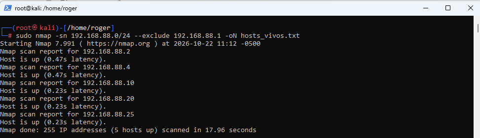
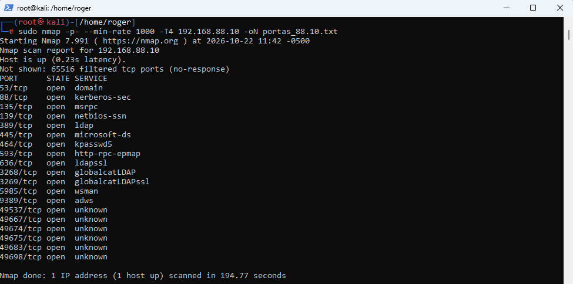
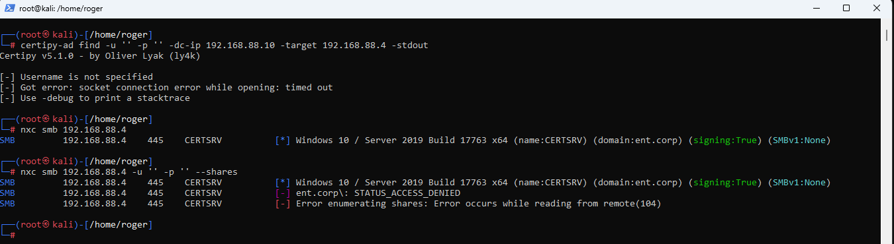

# ADCS Cross-Forest Attack and Detection

Estudo das técnicas de ataque em Active Directory abordadas na certificação CRTSv2 (Certified Red Team Specialist v2, CyberWarFare Labs), com foco em AD CS (ESC8), DCSync e abuso de confiança entre florestas. A ênfase está no entendimento da técnica e na detecção defensiva.


## Sobre este repositório

Material de estudo das técnicas que aparecem em ambientes Active Directory corporativos multi-floresta, no contexto da CRTSv2. O foco é explicar como cada técnica funciona, por que funciona, e como detectá-la e mitigá-la.

Cada módulo segue a mesma lógica. Primeiro a técnica e suas pré-condições, depois a execução conceitual (com comandos reais usando alvos genéricos), em seguida a detecção (regras Elastic e Wazuh) e por fim o hardening.

## Escopo e ética

Este material não é um writeup do exame. Não contém solução passo a passo, flags, nem credenciais do ambiente de exame. É um estudo de técnicas e de detecção, em respeito à integridade da certificação.

Os comandos usam alvos genéricos (por exemplo `<adcs-host>`, `<dc-ip>`, `<attacker-ip>`) justamente para ensinar a mecânica da técnica sem servir de gabarito. Qualquer reprodução deve ocorrer apenas em laboratório próprio ou em ambientes com autorização explícita.

## Técnicas abordadas

| Técnica | Tática MITRE ATT&CK | Módulo |
|---|---|---|
| AD CS Web Enrollment exposto (ESC8) | T1649 Steal or Forge Authentication Certificates | [01-adcs-esc8](01-adcs-esc8/) |
| NTLM Relay via coerção MS-EFSR | T1557 Adversary-in-the-Middle | [01-adcs-esc8](01-adcs-esc8/) |
| DCSync | T1003.006 OS Credential Dumping | [02-dcsync](02-dcsync/) |
| Abuso de confiança entre florestas (Foreign Security Principal) | T1482 Domain Trust Discovery, T1550.002 Pass the Hash | [03-cross-forest-fsp](03-cross-forest-fsp/) |

## A cadeia de ataque, visão geral

O encadeamento das técnicas forma um caminho de comprometimento total, de zero credencial até Domain Admin em uma segunda floresta.

```
Sem credencial
   │
   │  AD CS Web Enrollment exposto por HTTP (ESC8)
   │  + coerção MS-EFSR da conta de máquina do DC
   ▼
Certificado válido da conta de máquina do DC  ──►  hash NT da conta (PKINIT)
   │
   │  Conta de DC tem direito de replicação de diretório
   ▼
DCSync  ──►  segredos do domínio (incluindo Administrator e krbtgt)
   │
   │  Enumeração de trust revela Foreign Security Principal
   │  membro de Builtin\Administrators na floresta vizinha
   ▼
Pass the Hash na conta FSP  ──►  Domain Admin na segunda floresta
```

## Estrutura

```
adcs-crossforest-attack-detection/
├── README.md
├── 01-adcs-esc8/
│   ├── README.md          # a técnica, conceito e pré-condições
│   ├── attack.md          # como a técnica funciona (conceitual)
│   ├── detection.md       # regras Elastic e Wazuh
│   ├── mitigation.md      # hardening
│   └── images/
├── 02-dcsync/
│   └── (mesmo padrão)
├── 03-cross-forest-fsp/
│   └── (mesmo padrão)
├── detection-rules/
│   ├── elastic/           # regras EQL e KQL prontas
│   └── wazuh/             # regras XML e decoders
├── images/
└── references.md
```

## Reconhecimento (contexto)

O estudo parte de um ambiente multi-floresta com dois Domain Controllers e hosts membros, um deles expondo aplicação web. A descoberta de superfície usa nmap e gobuster.







As imagens servem de ilustração de metodologia. Os valores de endereço são de um laboratório isolado.

## Como ler

1. Comece pelo [01-adcs-esc8](01-adcs-esc8/) para entender a obtenção de credencial sem autenticação prévia.
2. Siga para [02-dcsync](02-dcsync/), que mostra o que uma identidade de DC permite extrair.
3. Termine em [03-cross-forest-fsp](03-cross-forest-fsp/), o pivô entre florestas via Foreign Security Principal.
4. Em cada módulo, a seção de detecção é a parte que mais importa para quem defende.

## Ferramentas de referência

Todas as ferramentas usadas são públicas e de uso legítimo em red team e pentest.

- Certipy (certipy-ad), enumeração e abuso de AD CS
- Coercer, coerção de autenticação (MS-EFSR, MS-RPRN e outros)
- Impacket (secretsdump, lookupsid), replicação e enumeração
- NetExec (nxc), execução e enumeração autenticada
- nmap e gobuster, descoberta e enumeração de superfície

## Aviso legal

Conteúdo exclusivamente educacional e defensivo. O autor não se responsabiliza por uso indevido. Técnicas ofensivas só devem ser executadas em ambientes próprios de laboratório ou com autorização formal por escrito.
